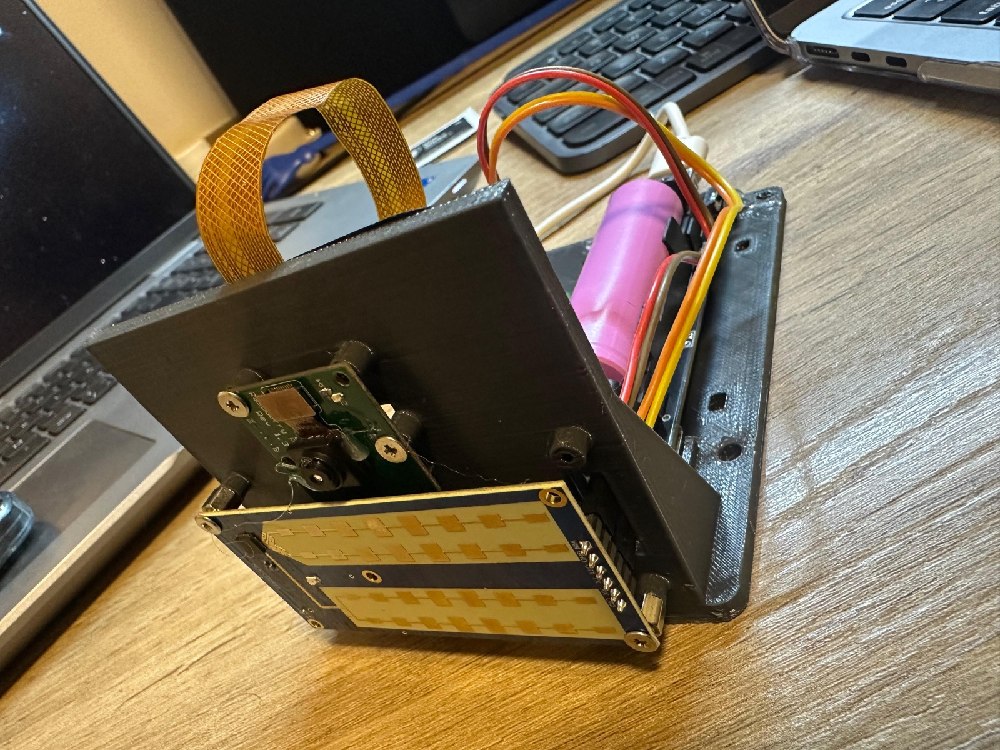
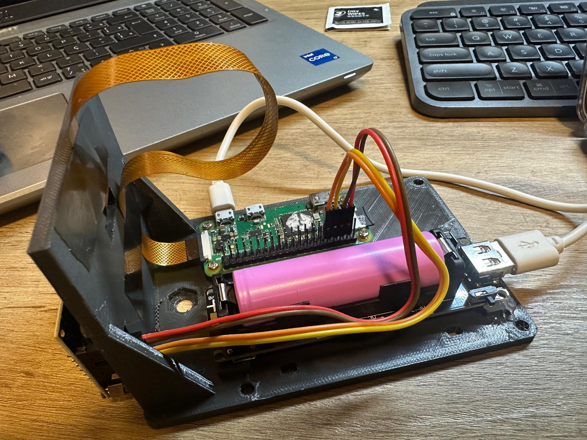
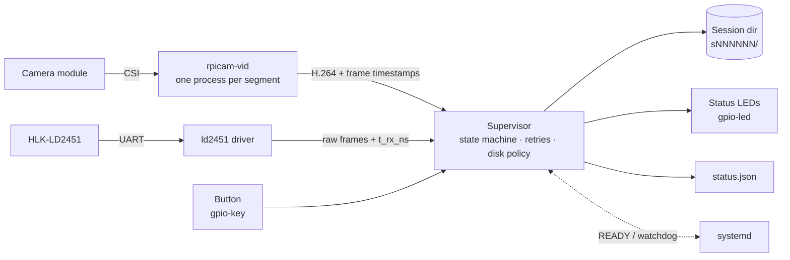

<div align="center">

# radar-cam-recorder

**An unattended Raspberry Pi recorder for time-aligned camera video and HLK-LD2451 radar data.**

[](https://github.com/bfMendonca/radar-cam-recorder/actions/workflows/ci.yml)
[](pyproject.toml)
[](LICENSE)
[](https://github.com/astral-sh/ruff)
[](https://mypy-lang.org/)
[](https://github.com/astral-sh/uv)
<br>
[](#hardware)
[](https://github.com/bfMendonca/radar-cam-recorder/stargazers)
[](https://github.com/bfMendonca/radar-cam-recorder/network/members)
[](https://github.com/bfMendonca/radar-cam-recorder/commits/master)

[Features](#features) ·
[Hardware](#hardware) ·
[Install](#installation) ·
[Configuration](#configuration) ·
[LEDs and button](#status-leds-and-button) ·
[Session format](#session-format) ·
[Contributing](CONTRIBUTING.md)

<br>




<sub>The prototype: camera and LD2451 radar on the front plate, Raspberry Pi Zero and battery on the base.</sub>

</div>

---

`radar-cam-recorder` turns a Raspberry Pi Zero, a camera module and a
[Hi-Link HLK-LD2451](https://www.hlktech.com/en/Goods-245.html) 24 GHz vehicle radar into a
self-contained "speed trap" data logger. It starts at boot, records video (`rpicam-vid`) and
raw radar frames into numbered sessions on a shared monotonic clock, and keeps going through
device failures, full disks and power cuts. Two LEDs and a single button let you run it in
the field without a laptop.

The radar is driven by the companion [`ld2451`](https://github.com/bfMendonca/ld2451) driver.

## Features

- **Time-aligned recording**: every video frame carries its kernel sensor timestamp and every
  radar frame its `CLOCK_BOOTTIME` receive time, so the two streams line up to about 50 ms.
- **Built to run unattended**: `systemd` `Type=notify` service with a watchdog; camera and
  radar failures are retried with exponential backoff and logged as incidents; a camera
  that stays alive but stops delivering frames is detected and restarted.
- **Safe with storage**: stop/resume free-space thresholds, atomic metadata writes, and
  sessions left `in_progress` by a crash or power cut are marked `interrupted` on the next start.
- **Segmented sessions**: video and radar rotate together into fixed-length segments, with
  per-segment frame-drop statistics.
- **Field controls**: green and red status LEDs and one button (split, start/stop, and a 5 s
  hold to power off) through kernel `gpio-led`/`gpio-key` devices, with no Python GPIO library.
- **Analysis-friendly reader**: `open_session()` gives you a summary, nearest-frame lookup
  and a merged, time-ordered timeline of video frames and radar reports.
- **Develop without hardware**: a fake camera and a loopback radar run the whole pipeline on
  a laptop. Fully typed (`mypy --strict`), with a test suite that needs no devices.

## How it works



The supervisor owns one session at a time. Each segment gets a fresh `rpicam-vid` process
and a new radar capture file; a watchdog on the frame metadata and a radar silence timeout
turn stalled devices into retried failures instead of silent gaps.

## Hardware

| Part | Notes |
| --- | --- |
| Raspberry Pi Zero / Zero W | Tested on Raspberry Pi OS (bookworm), 32-bit, Python 3.11 |
| Raspberry Pi camera module | Any module supported by `rpicam-vid`; defaults are 1296x972 @ 25 fps |
| HLK-LD2451 radar | On the Pi's hardware UART (`/dev/serial0`) |
| Green and red LED, 2 x 330 ohm, push button | Optional: status and control |
| Power | A 5 V supply or a battery/UPS board |
| 3D-printed mount | [`hardware/pizero-radar-cam-testplate.stl`](hardware/pizero-radar-cam-testplate.stl): holds the camera, radar, Pi Zero and battery board (shown in the photos above) |

### Wiring

| Part | Pi side (physical pin) | Wiring |
| --- | --- | --- |
| Radar 5V / GND | 2 (5 V) / any GND | |
| Radar TX | 10 (GPIO 15, RXD) | radar TX -> Pi RX |
| Radar RX | 8 (GPIO 14, TXD) | radar RX -> Pi TX |
| Green LED | 11 (GPIO 17) | GPIO -> 330 ohm -> LED anode, cathode -> GND (pin 9) |
| Red LED | 13 (GPIO 27) | GPIO -> 330 ohm -> LED anode, cathode -> GND (pin 14) |
| Button | 5 (GPIO 3) | GPIO 3 -> button -> GND (pin 6) |

Enable the serial port and disable the serial console (`raspi-config` → Interface Options →
Serial Port); see the [`ld2451` README](https://github.com/bfMendonca/ld2451#wiring) for details.
GPIO 3 has a fixed on-board pull-up, and grounding it wakes a halted Pi, so the same button
powers the Pi back on after a long-press shutdown (to be confirmed by the hands-on check in
[`docs/pi-acceptance.md`](docs/pi-acceptance.md)). Consequence: keep `i2c_arm` disabled in
`config.txt`.

## Installation

### On a development machine

```sh
git clone https://github.com/bfMendonca/radar-cam-recorder.git
cd radar-cam-recorder
uv sync --all-groups
uv run pytest -q
```

The repo's `.python-version` is 3.9 for development. Try the whole pipeline without
hardware using the hidden `--fake` option (fake camera and loopback radar):

```sh
uv run radar-cam-recorder run --fake --config my-dev.toml
```

### On the Pi

Install uv (release 0.10.10, `arm-unknown-linux-musleabihf` build) into `~/.local/bin`:

```sh
mkdir -p ~/.local/bin
curl -sSfL https://github.com/astral-sh/uv/releases/download/0.10.10/uv-arm-unknown-linux-musleabihf.tar.gz | tar xz -C /tmp
install -m 755 /tmp/uv-arm-unknown-linux-musleabihf/uv ~/.local/bin/uv
uv --version
```

The repo's `.python-version` (3.9) is for development. On the Pi, make uv use the system
Python 3.11 for every command by adding this to `~/.profile` (then log in again):

```sh
export UV_PYTHON=/usr/bin/python3
```

Then clone and build the environment:

```sh
git clone https://github.com/bfMendonca/radar-cam-recorder.git ~/radar-cam-recorder
cd ~/radar-cam-recorder
uv sync               # the test group pins a pure-Python hypothesis: nothing to compile
uv run pytest -q      # slow on a Pi Zero: allow several minutes
```

The service must run from this environment (`.venv/bin/radar-cam-recorder`). The service
user needs the groups `video` (camera), `dialout` (serial), and `gpio` and `input` (LEDs and
button).

## Configuration

Copy `deploy/config.example.toml` to `/etc/radar-cam-recorder.toml` and edit it; every key
is documented inline. Only `storage.recordings_dir` is required, and the directory must
exist. Check what the recorder will use:

```sh
radar-cam-recorder check-config --config /etc/radar-cam-recorder.toml
```

Set `camera.enabled = false` or `radar.enabled = false` to record one device only.

`camera.stall_timeout_s` (default 10 s) is the frame watchdog: if `rpicam-vid` stays alive
but its frame metadata stops growing for that long, the recorder logs a `camera stalled`
incident, stops the camera and restarts it as a camera failure (state `degraded`,
`camera missing`, retried with backoff). A new run gets the same time to deliver its
first frame.

## Service

```sh
sudo cp deploy/radar-cam-recorder.service /etc/systemd/system/
sudo systemctl daemon-reload
sudo systemctl enable --now radar-cam-recorder
journalctl -u radar-cam-recorder -f
radar-cam-recorder status --config /etc/radar-cam-recorder.toml
```

The unit assumes user `pi` and a checkout in `/home/pi/radar-cam-recorder`: adjust `User=`,
`WorkingDirectory=`, `ExecStart=` and `ExecStopPost=` to your install.

The unit is `Type=notify` with `WatchdogSec=30`: the recorder sends `READY=1` and a
watchdog ping each tick, and a hung main loop is killed and restarted by systemd. Its
`ExecStopPost` LED script is described in [Status LEDs and button](#status-leds-and-button).

`KillMode=mixed` matters: with the default (control-group) mode systemd would send
SIGTERM to `rpicam-vid` as well, preempting the recorder's own clean stop (SIGINT, so
the video file is finalised). With `mixed` only the recorder gets SIGTERM; any leftover
process is SIGKILLed after `TimeoutStopSec`.

## Status LEDs and button

A green and a red LED and one push button on the Pi's GPIO header show the recorder state
and control it without a laptop. All are kernel devices (no Python GPIO library); see
[Wiring](#wiring) for the pins. LEDs and button are optional: a missing device is logged
once and ignored.

### Kernel setup (once, on the Pi)

Files under `deploy/`; the logind drop-in goes first:

```sh
sudo install -D -m 644 deploy/logind-rcr-button.conf /etc/systemd/logind.conf.d/logind-rcr-button.conf
sudo systemctl restart systemd-logind
sudo install -m 644 deploy/rcr-leds.conf /etc/modules-load.d/rcr-leds.conf
sudo install -m 644 deploy/99-rcr-leds.rules /etc/udev/rules.d/99-rcr-leds.rules
sudo cp /boot/firmware/config.txt /boot/firmware/config.txt.bak-rcr
grep -q rcr-green /boot/firmware/config.txt || \
  sudo sh -c 'cat deploy/config.txt.snippet >> /boot/firmware/config.txt'
sudo reboot
```

| File | Purpose |
| --- | --- |
| `config.txt.snippet` | Two `gpio-led` overlays (`rcr-green` on GPIO 17 with a 1 Hz `timer` blink from kernel start, `rcr-red` on GPIO 27) and a `gpio-key` overlay on GPIO 3 (active low, pull-up, `KEY_POWER`). The input device is named `button@3`. |
| `rcr-leds.conf` | Loads the `ledtrig-pattern` module. |
| `99-rcr-leds.rules` | Lets group `gpio` write the `rcr-*` LED attributes. |
| `logind-rcr-button.conf` | `HandlePowerKey=ignore`, `HandlePowerKeyLongPress=poweroff`: logind powers the Pi off after a 5 s hold by itself, even if the recorder is hung. |
| `rcr-leds-stop.sh` | The unit's `ExecStopPost`: red solid after a crash or kill (`$SERVICE_RESULT` not `success`); after a clean stop both LEDs go off, except during system poweroff, when the "shutting down" blink is left running. |

### Modes and the button

The recorder records as soon as it starts (`[control] start_mode = "record"`, the default),
so an unattended install keeps recording after power-on and restarts. For button-driven use,
set `start_mode = "idle"`: the recorder then starts idle (running, not recording) on every
start and waits for a double press (or `USR2`). Edit `/etc/radar-cam-recorder.toml`: if the
file already has a `[control]` table (a copy of `deploy/config.example.toml` does), set
`start_mode` inside it; a second `[control]` table is invalid TOML and the service would fail
to load its config. If there is none, add this table:

```toml
[control]
start_mode = "idle"
```

Validate, then restart the service:

```sh
radar-cam-recorder check-config --config /etc/radar-cam-recorder.toml
sudo systemctl restart radar-cam-recorder
```

| Press | In idle | While recording or degraded | Waiting for devices, disk full, storage missing |
| --- | --- | --- | --- |
| Single | rejected | close the session (`complete`, safe to copy) and open a new one | rejected |
| Double | start recording | stop, back to idle | stop, back to idle |
| Hold 5 s | Pi powers off (done by logind) | same | same |

In `starting`, `stopping` and `error`, or while a split, start or stop is still running,
presses are rejected. Single < 1 s with no second press within 400 ms; double = a second
press within 400 ms; holds between 1 s and 5 s are ignored. Timings are in `[control]`.

The same commands as signals, for SSH and testing (`SIGUSR1` = single, `SIGUSR2` =
double). Always use `--kill-whom=main`: a plain `systemctl kill` also signals
`rpicam-vid`, and SIGUSR2 makes it quit.

```sh
sudo systemctl kill --kill-whom=main -s USR1 radar-cam-recorder   # split
sudo systemctl kill --kill-whom=main -s USR2 radar-cam-recorder   # start / stop
```

### LED meaning

| Meaning (state) | Green | Red |
| --- | --- | --- |
| Kernel boot (before the recorder runs) | 1 Hz blink (timer) | off |
| Recorder `starting` | fast blink | off |
| Idle, ready | steady on | off |
| Idle after a problem (crash, kill, watchdog, interrupted session) until the next press | steady on | slow blink |
| Recording, all OK | pulses while data reaches the disk | off |
| Recording, a device missing (`degraded`) | pulses while data arrives | 1 blink per cycle = camera missing, 2 = radar missing |
| Waiting for both devices | off | 1 + 2 blinks alternating |
| Storage full or missing | slow blink, alternating with red | slow blink |
| Broken, needs a laptop (`error`, crash) | off | solid |
| Shutting down (`stopping`, and during poweroff; also shown when the recorder is `stopped`) | fast blink | fast blink |
| Off: safe to unplug | off | off |

Green never claims "recording" without data: the recorder re-arms a finite kernel pulse
whenever the camera or radar makes progress, so green goes dark within 5 s if the recorder
freezes or dies. Radar data is counted when it is read and reaches the disk at the next
storage check, so with the camera missing the pulse can run ahead of the radar data on disk
by up to `[storage] check_interval_s` (5 s by default).

Brief overlays: press accepted = both LEDs flash once; rejected = red flashes twice; hold
past 5 s = red fast blink until power-off (cleared, with a warning in the journal, if the
Pi is still running 10 s later).

## Commands

| Command | Purpose |
| --- | --- |
| `run [--config PATH] [-v]` | Record at start (or idle until a command with `start_mode = "idle"`); runs until SIGTERM/SIGINT; exit 0 after a signal stop, 1 on config error or crash. |
| `status [--config PATH]` | Print the live status file (`recording.status_file`); exit 1 if missing. |
| `check-config [--config PATH]` | Print the parsed configuration as JSON. |
| `inspect SESSION_DIR [--json]` | Print the session summary (frames, fps, gaps, radar reports, overlap). |

The default config path is `/etc/radar-cam-recorder.toml`.

## Session format

Each run creates `recordings_dir/sNNNNNN/` containing:

- `session.json`: metadata, devices, clock samples and `state` (`in_progress`,
  `complete`, `interrupted`, ...);
- `events.jsonl`: state changes and incidents (`camera exited`, `camera stalled`,
  `segment gap`, `frame drops`, `radar silent`, ...);
- per segment: the H.264 video, a CSV of per-frame sensor timestamps, and the raw radar
  capture (`t_rx_ns,hex` lines).

Each closed segment in `session.json` also records `drops` (frame intervals longer than
1.5 frame periods) and `max_gap_ns` (its longest frame interval).

Timestamps: the radar's `t_rx_ns` is `CLOCK_BOOTTIME`, read by the recorder when the
bytes arrive. The camera's `SensorTimestamp` is the kernel's frame timestamp; on a Pi,
which never suspends, it equals `CLOCK_BOOTTIME`, and the clock samples in
`session.json` (boot, monotonic and wall clock read together) allow a correction if
that ever differs. A session left `in_progress` by a crash or power cut is marked
`interrupted` once the recordings dir is usable again (before the next session opens).

## Reading sessions

```python
from pathlib import Path
from radar_cam_recorder.reader import open_session

session = open_session(Path("recordings/s000001"))
print(session.summary())
for item in session.timeline():   # video frames and radar reports in time order
    ...
frame = session.frame_at(ts_ns)   # nearest video frame to a timestamp, or None
```

`timeline()` already shifts radar reports by `radar_latency_ns`; `frame_at()` does not,
so for a radar report pass
`report.t_rx_ns - session.metadata["radar_latency_ns"]`.

## Copying sessions

Skip sessions that are still being written (`state` is `in_progress`) or whose
`session.json` is unreadable. The exclude list is built on the Pi by parsing the JSON:

```sh
PI=raspberrypi.local   # SSH host of your Pi
skip=$(mktemp)
ssh "$PI" 'python3 -c "import json,pathlib
for p in sorted(pathlib.Path.home().joinpath(\"recordings\").glob(\"*/session.json\")):
    try:
        if json.loads(p.read_text()).get(\"state\") == \"in_progress\": print(p.parent.name + \"/\")
    except (OSError, ValueError): print(p.parent.name + \"/\")"' > "$skip"
rsync -av --exclude-from="$skip" "$PI":recordings/ ./recordings/
rm -f "$skip"
```

## Known limits

- Each segment rotation leaves a gap of about 3 s in the video (`segment gap` incident):
  measured on the Pi over 26 rotations of 300 s segments, 2.5-3.8 s, median 3.0 s. It is
  the time `rpicam-vid` takes to stop and to deliver the first frame of the next run.
- In-segment frame drops are normal at the default 1296x972@25 (about 300 per 300 s
  segment, longest usually 0.1-1 s): one `frame drops` incident per segment.
- Right after boot the camera stack needs about 10 s: expect one `camera exited` (or
  `camera stalled`) incident and a short `degraded` spell before recording settles.
- Video and radar are aligned to about 50 ms.
- The Pi Zero has no RTC: wall-clock times are unreliable until NTP syncs, so rely on
  the monotonic timestamps and the recorded clock samples.

## Documentation

- [`docs/pi-acceptance.md`](docs/pi-acceptance.md): hands-on acceptance checks and measured results on a Pi Zero.
- [`docs/leds-button-spike.md`](docs/leds-button-spike.md): kernel LED and button findings.
- [`CHANGELOG.md`](CHANGELOG.md): release notes.

## Contributing

Bug reports, field results and pull requests are welcome; see
[CONTRIBUTING.md](CONTRIBUTING.md). Please report security issues privately as described in
[SECURITY.md](SECURITY.md).

## License

[MIT](LICENSE) © Bruno Mendonça

## Star history

<a href="https://star-history.com/#bfMendonca/radar-cam-recorder&Date">
  <picture>
    <source media="(prefers-color-scheme: dark)" srcset="https://api.star-history.com/svg?repos=bfMendonca/radar-cam-recorder&type=Date&theme=dark">
    <source media="(prefers-color-scheme: light)" srcset="https://api.star-history.com/svg?repos=bfMendonca/radar-cam-recorder&type=Date">
    
  </picture>
</a>
